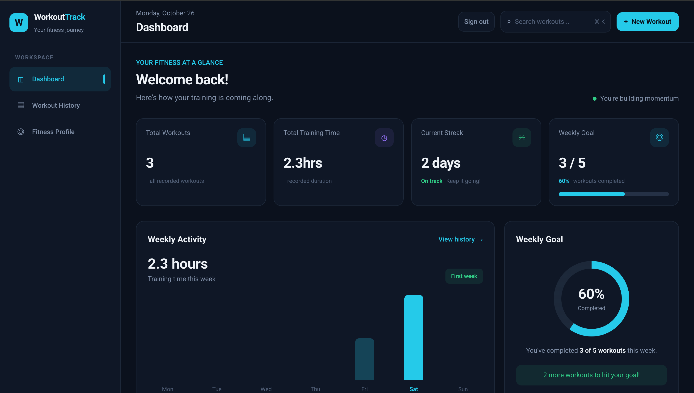
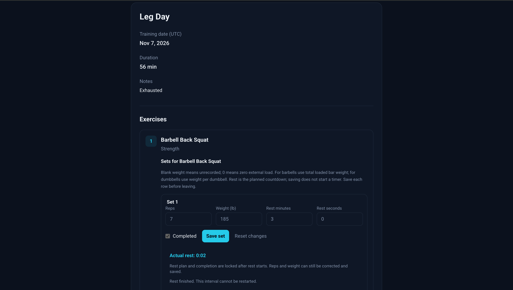

# Workout Tracker

A full-stack application for recording workouts, reviewing training history,
and building consistency. Users can manage exercises and sets, track weekly
activity, and explore personalized energy estimates.

[View the live application](https://workout-tracker-v01.vercel.app/welcome)

## Screenshots

### Dashboard



### Workout details



## Features

- Public landing page and responsive application interface.
- Email/password registration and sign-in, plus Google and GitHub sign-in.
- Private workout records with server-side authentication and ownership checks.
- Create, view, edit, and delete workouts.
- Manage workout exercises and sets, with a rest timer.
- Paginated workout history with date-range filters.
- Dashboard statistics, weekly activity, streaks, and weekly goal progress.
- Fitness profiles with BMR, TDEE, and calorie-target estimates.
- Shared Redis rate limiting for registration and password sign-in.

Energy estimates are informational and are not medical advice.

## Tech Stack

| Area | Technology |
|---|---|
| Application | Next.js App Router, React, TypeScript |
| Styling | Tailwind CSS v4 |
| Authentication | Auth.js v5, Google, GitHub, Credentials |
| Validation | Zod |
| Password hashing | Argon2 |
| Database | MongoDB Atlas with Prisma 6 |
| Rate limiting | Upstash Redis |
| Hosting | Vercel |

## Getting Started

## Local Development

### Seed the exercise catalog

From the project root, run:

```bash
npx tsx prisma/seed-exercises.ts
```

The script loads environment configuration using Next.js's environment
loader. Confirm that the effective `DATABASE_URL` points to your development
or test database before running it.

Expected output:

```text
Shared catalog ready: 6 exercises.
```

The seed creates or updates six shared exercises using fixed IDs.
Rerunning it updates their catalog details without creating duplicates.
It does not delete unrelated exercises.

Before writing, the script checks whether any reserved ID belongs to a
custom exercise and stops if a collision is found.

The updates are performed individually, not as one transaction. If a run
fails partway through, resolve the error and rerun it.

### Requirements

- Node.js 24.x and npm.
- A MongoDB Atlas development database.
- An Upstash Redis database with REST credentials.
- Google and GitHub OAuth applications to test those sign-in methods.

Use development resources and credentials rather than production ones.

### 1. Install dependencies

From the project root:

```bash
npm ci
```

### 2. Configure environment variables

Create `.env.local` with your own values:

```env
DATABASE_URL=your-development-mongodb-connection-string
AUTH_SECRET=your-local-authentication-secret
AUTH_GOOGLE_ID=your-development-google-client-id
AUTH_GOOGLE_SECRET=your-development-google-client-secret
AUTH_GITHUB_ID=your-development-github-client-id
AUTH_GITHUB_SECRET=your-development-github-client-secret
AUTH_TRUST_HOST=true
SITE_URL=http://localhost:3000
UPSTASH_REDIS_REST_URL=https://your-database.upstash.io
UPSTASH_REDIS_REST_TOKEN=your-rest-token
```

Generate an authentication secret locally:

```bash
node -e "console.log(require('node:crypto').randomBytes(32).toString('base64'))"
```

Never commit environment files or secret values.

Prisma CLI configuration loads `.env` through `dotenv/config`. Add
`DATABASE_URL` to a local `.env` file as well, using the same development
database connection string.

Configure the development OAuth callback URLs:

| Provider | Callback URL |
|---|---|
| Google | `http://localhost:3000/api/auth/callback/google` |
| GitHub | `http://localhost:3000/api/auth/callback/github` |

The Upstash token must support writes because rate limiting updates counters.

### 3. Prepare the development database

Ensure Atlas network access permits connections from your computer.
For a new development database, synchronize the Prisma schema:

```bash
npx prisma db push
npx prisma generate
```

Review database changes before applying them. Do not use a production
database for local setup or destructive tests.

This project uses MongoDB, so schema synchronization uses `db push`
rather than Prisma Migrate.

### 4. Start development

```bash
npm run dev
```

Open http://localhost:3000/welcome to view the public landing page.

Create an account through `/register`, then sign in. The root route `/`
shows the dashboard to authenticated users and redirects signed-out visitors
to `/welcome`.

## Validation

Run unit tests, TypeScript checks, and ESLint:

```bash
npm run check
```

These checks can also be run separately:

```bash
npm run test
npm run typecheck
npm run lint
```

### Production build

```bash
npm run build
npm run start
```

The build generates Prisma Client and creates an optimized Next.js build
using Webpack. Stop the development server before starting the production
server on the same port.


### Integration tests

The integration suite sends HTTP requests to a running local application.
It requires:

- Two existing, distinct email/password accounts.
- A seeded exercise catalog containing at least one shared exercise.
- A development server connected to an isolated test database.
- Working Redis configuration for password sign-in.

Create `.env.integration.local` in the project root:

```env
INTEGRATION_BASE_URL=http://localhost:3000
INTEGRATION_EMAIL=first-test-account@example.com
INTEGRATION_PASSWORD=replace-with-first-test-password
INTEGRATION_SECOND_EMAIL=second-test-account@example.com
INTEGRATION_SECOND_PASSWORD=replace-with-second-test-password
```

Replace these placeholders with dedicated test-account credentials.
Never commit this file.

The accounts must already exist; the suite does not register them.

Start the application in one terminal:

```bash
npm run dev
```

Run the suite in another:

```bash
npm run test:integration
```

`INTEGRATION_BASE_URL` accepts only a local HTTP origin. This prevents
targeting a public deployment, but does not guarantee database isolation:
the running application's `DATABASE_URL` must point to a test database.

The integration environment file configures the test client. It does not
change the database configuration of an already running application.

The suite verifies:

- Stale set updates return a conflict and can be retried after reloading.
- Simultaneous updates produce one success and one conflict.
- A simultaneous rest start and set edit cannot overwrite each other.
- Anonymous requests return `401` without changing owner data.
- A second account receives `404` for another account's records.
- Mismatched workout, exercise attachment, and set IDs return `404`.

Tests create temporary workouts and register cleanup hooks that attempt
to delete them and verify their removal. Interrupted runs or connection
failures can leave temporary records; inspect test diagnostics if cleanup
fails.

The suite reuses shared catalog exercises without creating catalog entries.
It signs in twice per run, consuming the shared local sign-in allowance.
Repeated runs may trigger rate limiting.

Integration tests are not included in `npm run check`.

### Rate-limiting behavior

- Registration: 5 requests per identifier per 15-minute sliding window.
- Password sign-in: 10 attempts per identifier per 15-minute sliding window.
- Local development requests share the `local-development` identifier.
- Development and production counters use separate Redis prefixes.
- Restarting the application does not clear Redis counters.
- Registration returns HTTP `429` and `Retry-After` when blocked.
- If the limiter is unavailable, registration and password sign-in
  temporarily reject requests.

Client-IP identification is configured for deployment directly on Vercel.
Other production hosting environments require an appropriate trusted-proxy
configuration.

## Project Status

Deployed and actively maintained. Core workout management, authentication,
registration, and protected access have been tested in production on desktop
and mobile.

## Engineering Decisions

### Sharing rate limits across server instances

Vercel can run multiple application instances with separate memory.
Registration and password sign-in therefore use shared Redis counters,
so requests reaching different instances still consume the same allowance.

Limits run on the server before database lookup and password hashing or
verification. If the limiter is unavailable, these operations temporarily
reject requests rather than bypassing protection.

### Protecting workout ownership

API endpoints derive the user ID from the authenticated session and enforce
ownership on the server. Unauthenticated requests receive `401 Unauthorized`.
Requests for missing workouts or workouts owned by another user receive
`404 Not Found`, avoiding disclosure of another user's record existence.

Nested operations also verify that each set belongs to the specified
exercise attachment and that the attachment belongs to the specified workout.

### Preventing stale set updates

Workout sets use optimistic concurrency control to prevent one edit from
overwriting changes saved by another tab. Each update includes the version
the user loaded. A successful write atomically checks that version and
increments it; a stale update returns `409 Conflict`.

Version checks detect conflicting writes. They do not automatically
synchronize data between tabs.

## Known Limitations

- Password recovery and reset-email delivery are not implemented yet.
- Registration and password sign-in limits are IP-based, so users on a shared
  network share an allowance.
- Sign-in and registration temporarily reject requests when the rate-limiting
  service is unavailable.
